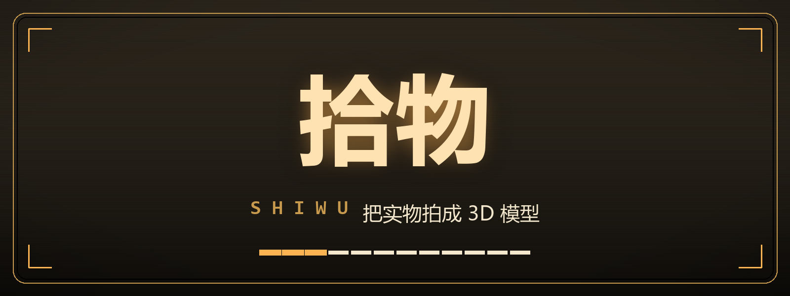

<div align="center">



**对着实物拍一圈，它就在手机里变成 3D 模型。**

<sub>Android 8.0+ · arm64-v8a · 3D 重建由群核 Aholo Lux3D 提供 · 2026 黑客松参赛作品</sub>

<br><br>


</div>

---

## 这是什么

一台装在手机里的复古扫描仪。不用建模软件、不用扫描仪、不用会画画——绕着想留下的东西走一圈，按几次快门，等一会儿，它就变成可以转着看、可以分享、可以导进别的软件的 3D 模型。

| 取景 | 参数 |
|:---:|:---:|
|  |  |
| <sub>取景屏里会自动框住要拍的东西</sub> | <sub>引擎、精度、区域、密钥都在这里</sub> |

| 资产仓库 | 3D 预览 |
|:---:|:---:|
|  |  |
| <sub>处理中、失败可重试、成品都在这一页</sub> | <sub>拖动旋转，双指缩放，一键分享 GLB</sub> |

## 三步上手

**① 对准** —— 把东西放进取景屏中间。画面里只有一个物体时会自动被四角框住；点别处可以改选目标。

**② 拍一圈** —— 短按旋钮拍一帧，指针每次转 45°。绕物体走一圈，**8–12 帧**最理想。

**③ 长按提交** —— 长按旋钮开始成像。画面闪一下，任务折进「资产」按钮，取景器立刻可以接着拍下一件。

> 第一次打开会弹出五页操作手册，读完就懂；之后可在配置页「操作引导」重看。

## 机身说明

| 部件 | 怎么用 |
|:---|:---|
| **旋钮 / SHUTTER** | 短按拍一帧，长按提交。外面那圈琥珀色进度环就是已拍帧数。 |
| **灯 / LIGHT** | 开关手电筒，暗处拍底片用。 |
| **配置 / CONFIG** | 引擎、精度、接口区域、演示模式、链路测试、导入底片、操作手册。 |
| **资产 / ARCHIVE** | 正在处理、失败可重试、已完成的模型都在这里，点一下进 3D 预览。 |
| **子显示屏** | 顶部窄屏：已拍帧数、进度、当前引擎与精度、操作提示。 |

## 拍得好的几个要点

- **光要匀**：自然光或均匀照明，避免一边强光一边全黑，别打闪光灯。
- **背景干净**：物体后面别放颜色接近的东西。
- **转着拍**：围着走一圈，视角变化大一些，别只在原地小幅挪动。
- **占满画面**：让物体占大部分取景，但别出画。
- **这些很难拍**：透明玻璃、镜面金属、纯色无纹理的平面、会动的东西。

## 关于密钥

重建能力来自**群核 Aholo Lux3D**，需要一个 API Key。

配置页最底部的「**服务舱 / SERVICE BAY**」可以在应用内一站式搞定：打开 Lux3D 控制台 → 登录并复制密钥 → 回到应用自动读取剪贴板 → 校验通过后写入本机。

- 密钥**只保存在你的手机上**，界面里默认以圆点掩码显示，需要时点「显示」。
- **没有密钥也能试**：打开「演示模式」，全流程照常，结果换成内置示例模型。
- 生成会占用**你自己账号的额度**：极速引擎（G1-Turbo）约 1 分钟，精细引擎（G1）约 5 分钟。

## 常见问题

<details>
<summary><b>拍失败了怎么办？</b></summary>

底片会保留。资产页里那条失败记录可以直接「重试」，不用重拍。
</details>

<details>
<summary><b>模型糊、有破洞、缺一块？</b></summary>

多拍几帧（尤其物体背面和底部）、换到光线均匀的地方，或把精度调到「精细」再重试。
</details>

<details>
<summary><b>帧数满了？</b></summary>

上限 12 帧。拍完就提交，或先在配置页「清空底片」重来。
</details>

<details>
<summary><b>手边没网 / 不想花额度？</b></summary>

配置页「演示模式」可以完整走一遍流程；也可以把引擎切到「本地」，用机内重建——效果不如云端，但完全离线、不耗额度。
</details>

<details>
<summary><b>能直接用在别的软件里吗？</b></summary>

可以。成品是标准 GLB，分享或保存到「下载」后，Blender、网页 `<model-viewer>`、游戏引擎都能直接打开。
</details>

## 你的数据

- 底片照片只在**提交时**上传到群核 Aholo 用于重建；不提交就一直留在本机。
- 生成好的模型保存在应用私有目录，只有你导出或分享时才离开手机。
- API Key 只存在本机设置里，不随日志外传。

## 已知限制

<details>
<summary><b>展开查看</b></summary>

- 只提供 **64 位 ARM** 版本，老机型与模拟器装不上。
- 取景时相机常驻，切到面板也仍在运行（为了返回时能立刻拍），耗电略高。
- 深色物体紧贴线缆、支架时，自动框选可能连成一片，框会偏大——换个背景或点一下物体主体即可。
- 同一账号的并发任务有上限（免费额度 5 个），排队时会给出中文提示。
</details>

## 技术栈

| 层 | 用的是什么 |
|:---|:---|
| 语言 / UI | Kotlin 2.2.21、Jetpack Compose（BOM 2026.06.01）、Material 3 |
| 相机 | CameraX 1.4.1：预览、拍照、手电筒 |
| 主体框选 | MediaPipe Tasks Vision 0.10.21（MagicTouch 分割模型，端内推理，类别无关） |
| 图像预处理 | ExifInterface 摆正 + 机内压缩到长边 1280 |
| 机内重建（可选） | 纯 Kotlin Surface Nets + 自写 GLB 写出，OpenCV / ONNX Runtime 辅助 |
| 3D 重建（云端） | 群核 Aholo Lux3D `img-to-3d`（G1 / G1-Turbo），PBR 材质，输出 GLB |
| 网络 | OkHttp 4.12：Lux3D 网关 + OUS 文件直传 |
| 3D 预览 | WebView + 本地打包的 `<model-viewer>`（不依赖外网） |
| 图片加载 / 存储 | Coil 2.7、DataStore Preferences 1.1.1、应用私有目录 + `library.json` |
| 构建 | Gradle 8.14.3 + AGP 8.13.2，minSdk 26 / targetSdk 35 / compileSdk 36 |

## 从源码构建

<details>
<summary><b>开发者看这里</b></summary>

```bash
./gradlew assembleDebug          # Windows: gradlew.bat assembleDebug
# 产物：app/build/outputs/apk/debug/app-debug.apk
```

API Key 写在 `local.properties` 的 `aholo.api.key=`（该文件已在 `.gitignore` 中，不会进仓库），构建时注入为默认值；也可以在应用内「服务舱」里改。

- 工程路径含中文时依赖 `gradle.properties` 里的 `android.overridePathCheck=true`（已加）。
- 想用 x86 模拟器调界面，加 `-PwithX86 -PnoSubject` 出一个跳过主体分割的调试包；正式包仍是纯 arm64。
- 预览页用本地打包的 `model-viewer`，模拟器的软件 GPU 渲染不出 WebGL，真机正常。

</details>

---

<div align="center">
<sub>「拾物」为群核 Aholo 全球 3D AI 黑客松参赛作品，3D 重建能力由 Aholo Lux3D 提供。</sub>
</div>
