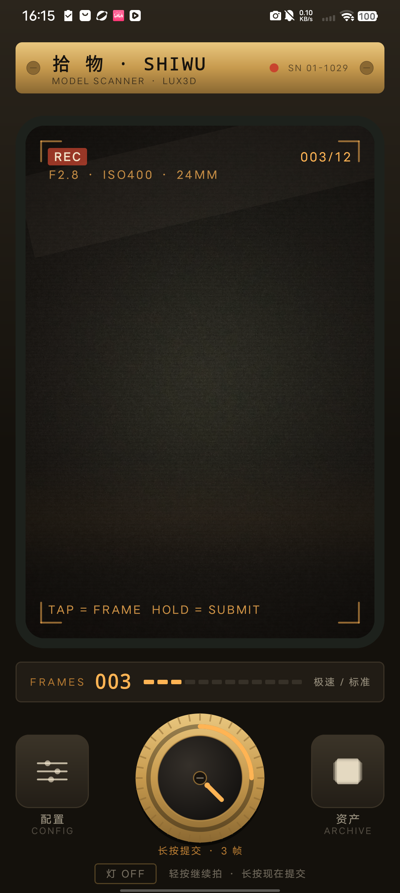
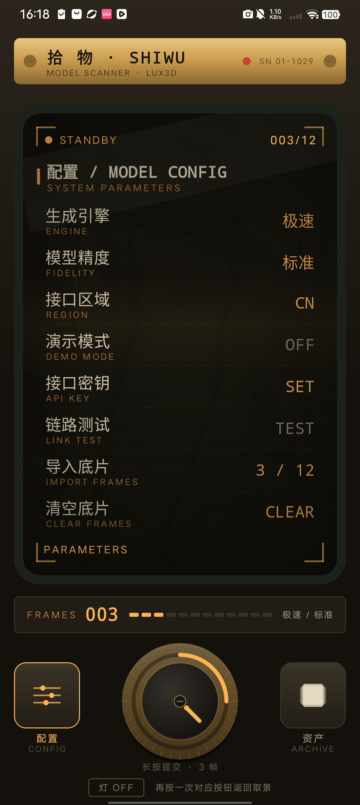
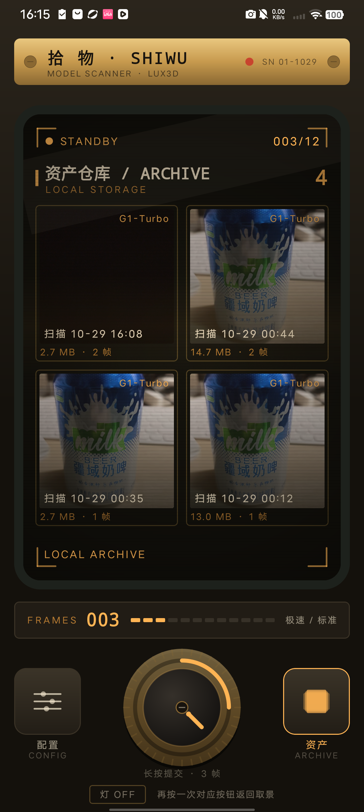
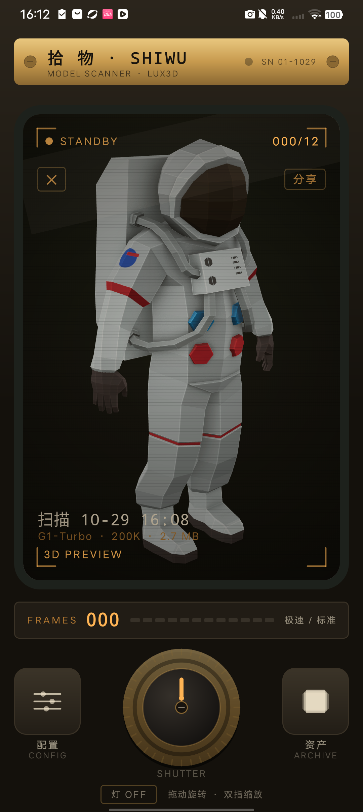
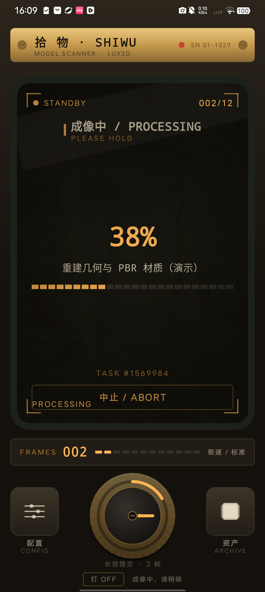
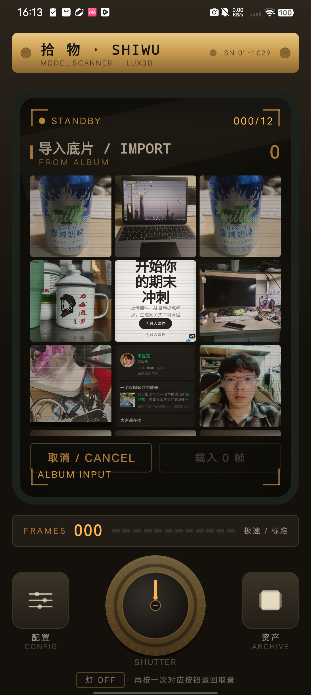

# 拾物 · 3D 扫描建模（Android Demo）

把手机做成一台虚构的**复古未来主义扫描仪**：转动旋钮拍底片，长按旋钮提交，
群核 Aholo Lux3D 重建几何与 PBR 材质，成品直接在取景屏里预览、分享 GLB。

- 包名：`com.shiwu.scan3d`
- 最低系统：Android 8.0（API 26），目标 API 35，compileSdk 36
- 技术栈：Kotlin + Jetpack Compose、CameraX、OkHttp、WebView(`<model-viewer>`)
- 视觉：炭黑机身 + 米色面板 + 黄铜旋钮 + 琥珀 CRT（无蓝紫配色）

## 界面

| 取景 / 扫描 | 参数配置 |
|---|---|
|  |  |

| 资产仓库 | 3D 预览 |
|---|---|
|  |  |

| 成像中 | 相册导入 |
|---|---|
|  |  |

---

## 一、跑起来

### 1. 用 Android Studio 打开

直接打开本仓库根目录，等待 Gradle Sync 完成即可。

### 2. 命令行构建

```bash
./gradlew assembleDebug          # Windows: gradlew.bat assembleDebug
# 产物：app/build/outputs/apk/debug/app-debug.apk
```

> 工程路径含中文时需要在 `gradle.properties` 保留 `android.overridePathCheck=true`（已加）。

### 3. 配置 API Key

两个入口，后者覆盖前者：

1. `local.properties` 里的 `aholo.api.key=`（构建时写入 `BuildConfig.DEFAULT_API_KEY`）
2. 设备面板：配置 → 接口密钥

申请：<https://lux3d.aholo3d.cn/lux3d/home?entry_type=website&auth_action=get_api&from=lux3d&lang=zh_CN>

### 4. 演示模式

配置页打开「演示模式」（或留空 Key），全流程不调接口，用内置 `assets/demo_model.glb`
走完上传→成像→下载，用于没有额度时演示。

---

## 二、设备怎么用

| 部件 | 行为 |
|---|---|
| 旋钮 SHUTTER | **短按**：转 45° 并拍一帧（闪白 + 震动）；**长按**：按下并提交换能 |
| 配置 CONFIG | 取景屏切到参数菜单，再按一次返回取景 |
| 资产 ARCHIVE | 取景屏切到资产仓库，点任意模型进入 3D 预览 |
| 灯 OFF/ON | 手电筒，暗光下拍底片用 |
| 计数条 | 当前帧数 / 12 格 LED / 当前引擎与精度 |

**底片容量**：12 帧。单帧也能提交（等价于单图模式），8–12 帧更适合需要完整几何的物体。
Lux3D 接口本身支持 `imgs` 1–32 张，要放开改 `DeviceState.maxFrames` 与配置页的 `12`。

**配置项**：引擎（G1-Turbo / G1）、精度（12/20/30 万面）、接口区域（国内 / 国际）、
演示模式、API Key、链路测试、导入底片、清空底片。左右两个硬件按钮的状态会在
按钮边框与文字上点亮琥珀色。

---

## 三、核心流程与 API 映射

```
旋钮短按 → CameraX 取景 → 写入 files/scans/<session>/frame_*.jpg
        │
        ▼
长按提交 │ 压缩到长边 1280、按 EXIF 摆正          ImagePrep.kt
        │
        ▼
GET  /asset/v1/token                          AholoApi.fetchUploadToken
POST {globalDomain}/ous/api/v2/single/upload  （每张图单独取一次 token）
GET  /ous/api/v2/upload/status                轮询到 status=5 拿 url
        │
        ▼
POST /lux3d/v1/generate/img-to-3d/task/create
     { imgs:[url...], version, faceCount, outputFormat:["glb"], enablePbr:true }
        │
        ▼
GET  /lux3d/v1/generate/task/get?taskid=…
     d.status: 0/1 继续，3 成功，4 失败，6 取消
        │
        ▼
下载 GLB → files/models/<id>.glb → 取景屏内 model-viewer 预览
```

要点：

- Lux3D 用 `{f, c, m, d}` 信封，`c=="0"` 只代表请求成功，任务状态看 `d.status`。
- 结果 URL 约 2 小时过期，App 下载后落地，`library.json` 记录元数据。
- 上传凭证 `ousToken` 与单次上传任务绑定，所以每张图都要重新取 token。

| 环节 | 文件 |
|---|---|
| 网络与 OUS 上传 | `data/AholoApi.kt` |
| 图片压缩/EXIF | `data/ImagePrep.kt` |
| 流程编排、面板状态 | `ui/device/DeviceViewModel.kt` |
| 本地资产库 | `data/AssetStore.kt` |
| 3D 预览 | `ui/viewer/ModelViewer.kt` + `assets/viewer.html` |

---

## 四、目录结构

```
app/src/main/java/com/shiwu/scan3d/
├── MainActivity.kt / ShiwuApp.kt
├── data/
│   ├── AholoApi.kt          Lux3D + Asset 接口封装（OkHttp）
│   ├── AssetStore.kt        library.json / models 目录
│   ├── Gallery.kt           MediaStore 查询与权限
│   ├── ImagePrep.kt         压缩、EXIF 旋转、MD5
│   ├── Models.kt            Engine / Quality / AssetItem / JobUi
│   └── SettingsStore.kt     DataStore 设置
├── ui/
│   ├── device/
│   │   ├── DeviceScreen.kt  机身布局：铭牌 + 取景屏 + 控制面板
│   │   ├── CrtScreen.kt     玻璃、扫描线、暗角、HUD、快门闪光
│   │   ├── ShutterKnob.kt   黄铜旋钮（旋转 / 按压 / 帧数环）
│   │   ├── DevicePanels.kt  配置 / 仓库 / 进度 / 导入 / 预览浮层
│   │   └── DeviceViewModel.kt
│   ├── components/          CameraX 预览
│   ├── theme/Retro.kt       炭黑 + 黄铜 + 琥珀配色与等宽字阶
│   └── viewer/              WebView + model-viewer（支持深色底）
└── util/ExportUtils.kt      分享、保存到「下载」
```

---

## 五、设计说明

- **机身**：垂直炭黑渐变，顶部黄铜铭牌（螺丝、状态灯、SN），所有控件都有金属描边与内阴影。
- **取景屏**：墨绿玻璃 + 黄铜边条 + 扫描线 + 暗角 + 缓慢下扫的亮带；HUD 用等宽字，
  左上角 STANDBY/REC（拍过之后红色闪烁）与镜头参数，右上角帧计数，四角指示括号。
- **旋钮**：滚花外环、中央旋帽、琥珀指针，短按弹簧旋转 45°，外圈那一道进度环就是帧数。
- **面板**：琥珀等宽菜单通过 0.985 透明度的玻璃覆盖在实时取景上，会有轻微透出，
  像真正的 CRT 叠显。
- **预览**：`model-viewer` 采用深色背景，模型自带阴影，可拖动旋转、双指缩放。

---

## 六、已知限制

- 取景层常驻，切到面板后相机仍在运行（为了返回取景时能立即拍摄），耗电略高。
- WebView 里 `<model-viewer>` 的尺寸依赖 `window.innerHeight`，已用 JS 显式锁定，
  避免部分 ROM 把 `100vh` 算成 0。
- API Key 保存在本机 DataStore，未加密；正式产品应放服务端中转。
- 单账号并发受限（免费 5 个），并发满时返回
  `GENERATION_CONCURRENCY_LIMIT_EXCEEDED`，App 会给出中文提示。
