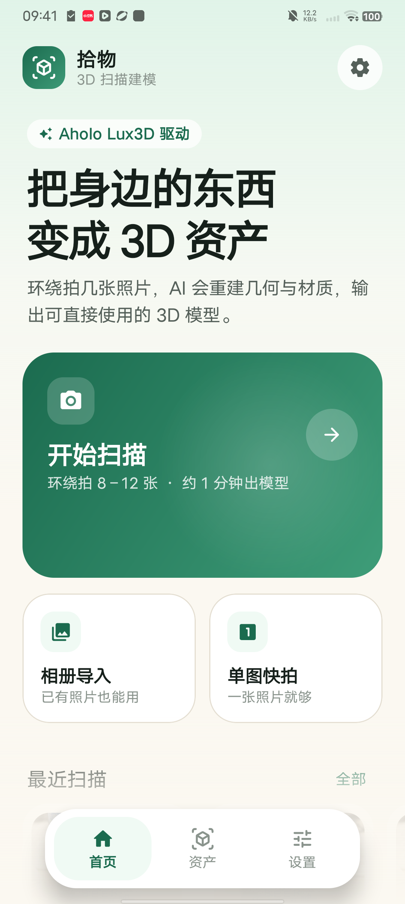
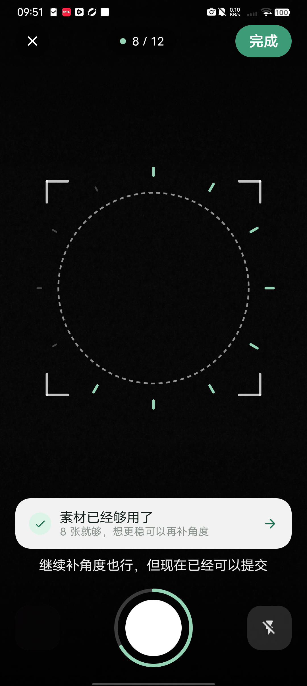
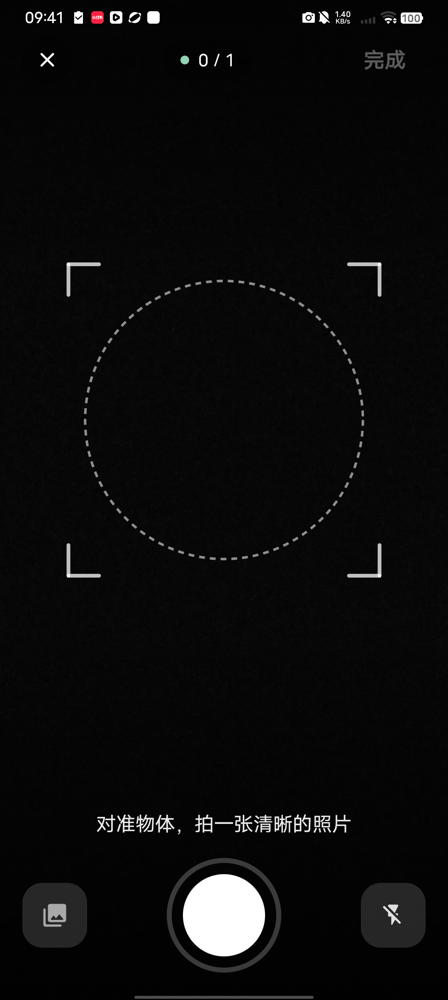
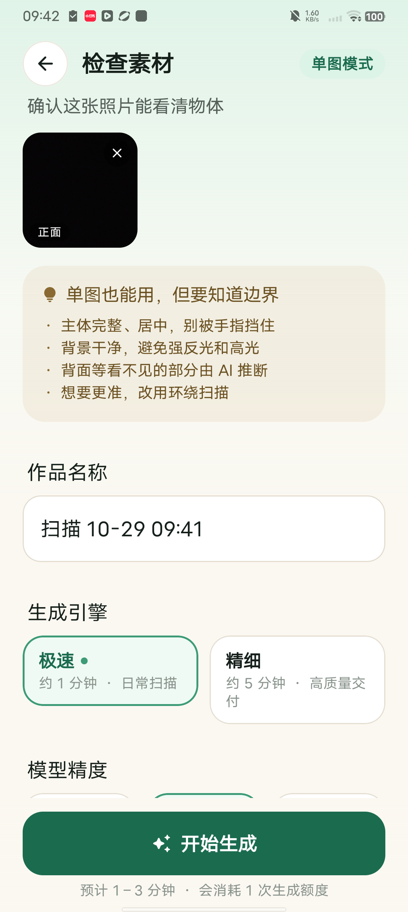
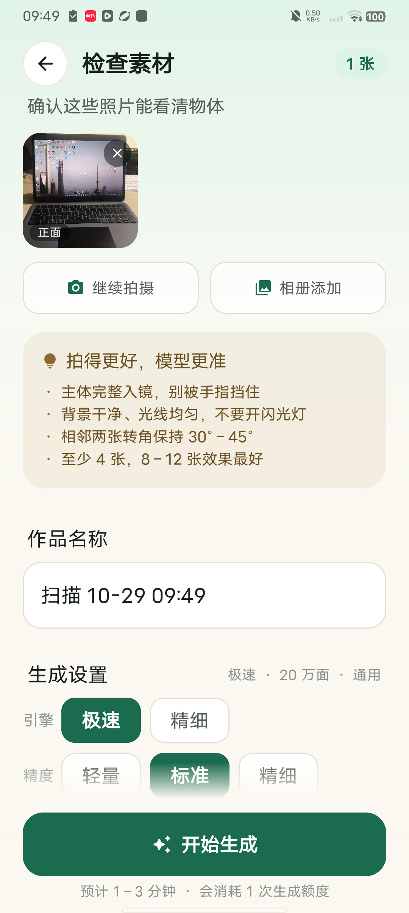
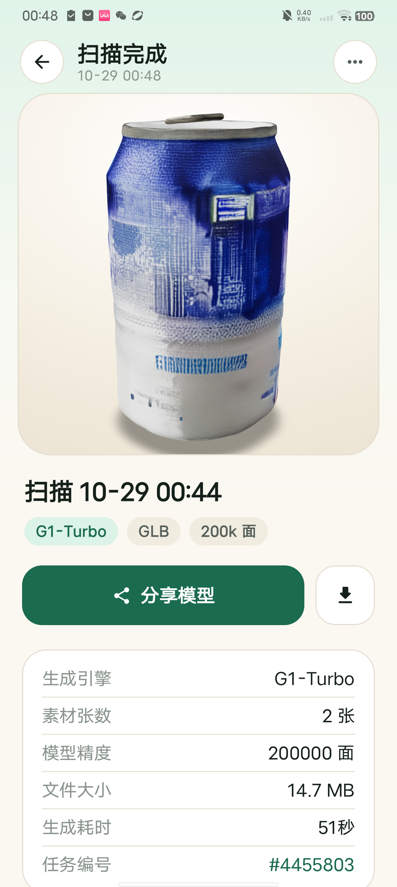
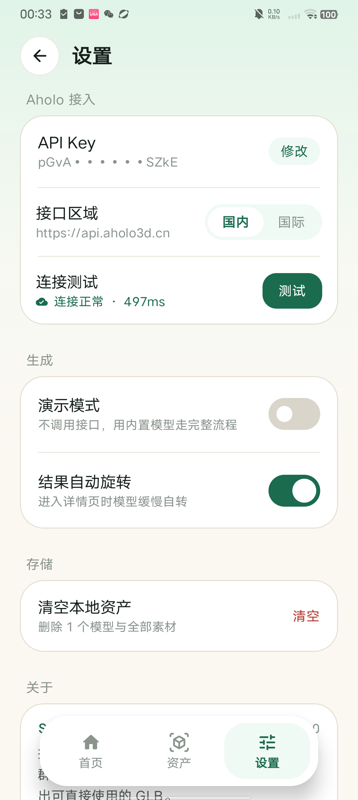

# 拾物 · 3D 扫描建模（Android Demo）

用手机环绕拍几张照片，调用群核 Aholo Lux3D 重建几何与 PBR 材质，在 App 内直接预览、
导出 GLB。为「群核科技 Aholo 全球 3D AI 黑客松」做的参赛 Demo。

- 包名：`com.shiwu.scan3d`
- 最低系统：Android 8.0（API 26），目标 API 35，compileSdk 36
- 技术栈：Kotlin + Jetpack Compose + Material 3、CameraX、OkHttp、Coil、WebView(`<model-viewer>`)

## 界面

| 首页 | 环绕拍摄（满 8 张提示可提交） |
|---|---|
|  |  |

| 单图快拍 | 单图检查 |
|---|---|
|  |  |

| 检查素材 | 3D 预览 |
|---|---|
|  |  |

| 设置 | |
|---|---|
|  | |

---

## 一、跑起来

### 1. 用 Android Studio 打开

直接打开本仓库根目录，等待 Gradle Sync 完成即可。

### 2. 命令行构建

```bash
./gradlew assembleDebug          # Windows: gradlew.bat assembleDebug
# 产物：app/build/outputs/apk/debug/app-debug.apk
```

> 注意：工程路径含中文时需要在 `gradle.properties` 保留 `android.overridePathCheck=true`
> （已加）。

### 3. 配置 API Key

有两个入口，优先级从低到高：

1. `local.properties` 里的 `aholo.api.key=`（构建时写入 `BuildConfig.DEFAULT_API_KEY`）
2. App 内「设置 → API Key」（写入 DataStore，覆盖默认值）

Key 申请：<https://lux3d.aholo3d.cn/lux3d/home?entry_type=website&auth_action=get_api&from=lux3d&lang=zh_CN>

### 4. 演示模式

设置里打开「演示模式」（或留空 API Key），全流程不调接口，用内置的
`assets/demo_model.glb` 走完上传→生成→下载，用于没有额度时演示。

---

## 二、三种入口

| 入口 | 行为 | 适用 |
|---|---|---|
| 开始扫描 | 环绕拍 4–12 张，拍满 **8 张会浮出「素材已经够用了」提示**，点一下直接进检查页 | 想要更准的几何 |
| 单图快拍 | 只拍 1 张，自动进检查页（顶部标记「单图模式」），不显示补拍入口 | 手上只有一张图 |
| 相册导入 | 从相册多选最多 12 张 | 已有素材 |

**容量**：App 上限 12 张；Lux3D 接口本身支持 `imgs` 1–32 张，要放开改三处常量即可
（`CaptureScreen.maxShots`、`ReviewScreen` 的 `< 12`、`GalleryScreen` 的 `< 12`）。

**单图模式**说明：走的是同一个 `img-to-3D` 接口，只是 `imgs` 里只有 1 个元素。
看不见的面由模型推断，检查页会明确写出这条边界，避免用户误以为和实拍多角度等价。

---

## 二、核心流程与 API 映射

```
相册导入 / 相机拍摄
        │
        ▼
   压缩到长边 1280、按 EXIF 摆正          ImagePrep.kt
        │
        ▼
GET  /asset/v1/token                    AholoApi.fetchUploadToken
POST {globalDomain}/ous/api/v2/single/upload   （每张图单独取一次 token）
GET  /ous/api/v2/upload/status          轮询到 status=5 拿 url
        │
        ▼
POST /lux3d/v1/generate/img-to-3d/task/create
     { imgs:[url...], version, faceCount, outputFormat:["glb"], enablePbr:true }
        │
        ▼
GET  /lux3d/v1/generate/task/get?taskid=…
     d.status: 0/1 继续，3 成功，4 失败，6 取消
        │
        ▼
下载 GLB → files/models/<id>.glb → WebView + <model-viewer> 预览
```

要点：

- Lux3D 用 `{f, c, m, d}` 信封，`c=="0"` 只代表请求成功，任务状态看 `d.status`。
- 结果 URL 约 2 小时过期，App 下载后落到本地，`library.json` 记录元数据。
- 上传凭证 `ousToken` 与单次上传任务绑定，所以每张图都要重新取 token。
- 图片压缩在 IO 线程做，1280 长边 + JPEG 88，单张约 200–400KB。

对应文件：

| 环节 | 文件 |
|---|---|
| 网络与 OUS 上传 | `data/AholoApi.kt` |
| 图片压缩/EXIF | `data/ImagePrep.kt` |
| 流程编排、进度、取消 | `ui/AppViewModel.kt` |
| 本地资产库 | `data/AssetStore.kt` |
| 3D 预览 | `ui/viewer/ModelViewer.kt` + `assets/viewer.html` |

---

## 三、目录结构

```
app/src/main/java/com/shiwu/scan3d/
├── MainActivity.kt / ShiwuApp.kt
├── data/
│   ├── AholoApi.kt          Lux3D + Asset 接口封装（OkHttp）
│   ├── AssetStore.kt        library.json / models 目录
│   ├── ImagePrep.kt         压缩、EXIF 旋转、MD5
│   ├── Models.kt            Engine / Quality / AssetItem / JobUi
│   └── SettingsStore.kt     DataStore 设置
├── ui/
│   ├── AppViewModel.kt      状态机 + 生成任务编排
│   ├── AppRoot.kt           页面切换 + 底部导航
│   ├── components/          通用组件、CameraX 预览
│   ├── screens/             Home / Capture / Gallery / Review / Progress / Result / Library / Settings
│   ├── theme/Theme.kt       薄荷绿 + 奶油白 Material 3 主题
│   └── viewer/              WebView + model-viewer
└── util/ExportUtils.kt      分享、保存到「下载」
```

---

## 四、设计说明

- **配色**：主色薄荷绿 `#1B6B4F`，背景奶油白 `#FBF8F1`，辅助暖沙/陶土色。
  明确避开蓝紫系 AI 观感；Material 3 语义色 + 自定义字阶。
- **首页**：Hero 文案 → 主行动卡片（渐变）→ 相册导入/单图快拍 → 最近扫描 → 三步说明。
- **取景页**：环形引导 + 刻度进度 + 角度提示（正面/右侧 45°…）+ 手电筒；
  单图模式不画刻度；满 8 张浮出可点击的提交提示。
- **检查页**：照片网格、可继续拍摄/相册添加、按模式切换的拍摄建议、
  紧凑的「引擎 / 精度」选择（一屏放得下），底部固定生成按钮。
- **生成页**：合成进度（Lux3D 不返回进度，用时间缓动逼近，成功后跳到 100%），
  四步状态列表，可取消。
- **结果页**：3D 预览（拖动旋转、双指缩放、自动旋转），元数据、分享/保存、技术栈说明。

---

## 五、已知限制

- 单账号并发受限（免费 5 个），批量生成会排队；并发满时接口返回
  `GENERATION_CONCURRENCY_LIMIT_EXCEEDED`，App 已做中文提示。
- 生成是「图生 3D」单物体能力，适合桌面小物件；大场景/房间请用 Aholo Reality 的 3DGS 重建。
- WebView 里 `<model-viewer>` 的尺寸依赖 `window.innerHeight`，已用 JS 显式锁定，
  避免部分 ROM 把 `100vh` 算成 0。
- API Key 保存在本机 DataStore，未做加密；正式产品应放服务端中转。

---

## 六、可以写进参赛材料的点

1. **Lux3D 是核心而非点缀**：每一条资产都由 `img-to-3D` 生成，没有兜底模型（演示模式除外）。
2. **完整异步链路**：OUS 直传 → 任务创建 → 轮询 → 下载 → 本地资产管理，全部在端上闭环。
3. **可继续进下游**：产物是标准 GLB，可分享到其他 App、保存到下载目录，
   后续可接 `multi-format-export`（USDZ/STL/3MF）做 AR 与 3D 打印。
4. **产品化细节**：压缩与 EXIF、并发与错误文案、取消、演示模式、资产库。
